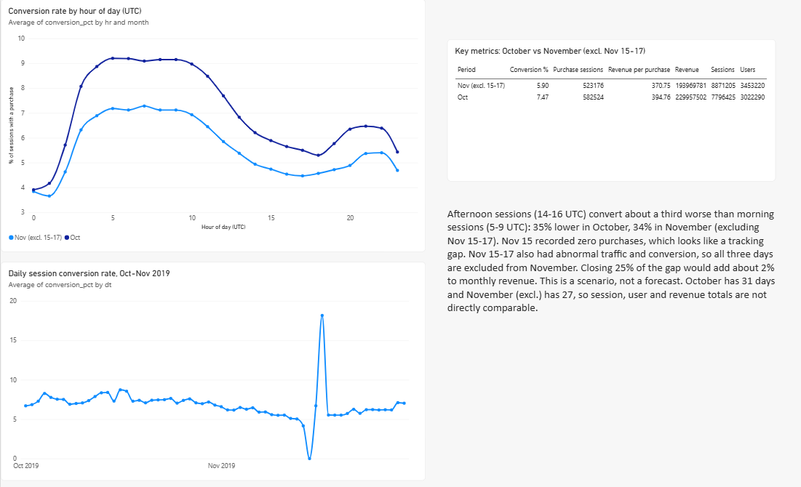

# E-commerce Session Conversion Analysis

*Morning vs afternoon conversion across 110M clickstream events (Oct-Nov 2019)*

An analysis of about 110 million clickstream events (October-November 2019) from a multi-category online store, built with SQL (DuckDB) and Power BI.

## Headline finding

**Afternoon sessions (14-16 UTC) convert about a third worse than morning sessions (5-9 UTC), in both months.** The gap is not explained by bounces, product category mix, new-vs-returning visitors, or weekday-vs-weekend mix. The data cannot say what does explain it, so the recommendation is to diagnose the cause before investing in a fix.



## Results at a glance

| | October | November (excl. Nov 15-17) |
|---|---|---|
| Sessions | 7,796,425 | 8,871,205 |
| Users | 3,022,290 | 3,453,220 |
| Session conversion | 7.47% | 5.90% |
| Morning conversion (5-9 UTC) | 9.16% | 7.16% |
| Afternoon conversion (14-16 UTC) | 5.92% | 4.74% |
| **Afternoon lower by** | **35.4%** | **33.8%** |
| 95% confidence interval for the gap | 34.0% to 36.7% | 32.2% to 35.2% |
| Days with afternoon lower | 31 of 31 | 27 of 27 |

October has 31 days and cleaned November has 27, so session, user and revenue totals are not directly comparable. Conversion rates are.

## Questions I asked

1. Where do sessions turn into purchases, and when?
2. Is the time-of-day difference real, or an artifact of bounces, category mix or visitor type?
3. Does the finding hold in a second month?
4. How much would closing part of the gap be worth?

## What I did

1. **Built sessions from raw events in SQL.** Sessions use a 30-minute inactivity rule (`LAG` plus a running `SUM`). I compared them with the dataset's own session ID, found it follows no clean time rule, and used my own definition.
2. **Chose one primary metric.** Session conversion, because about half of purchase sessions have no cart event, which makes cart-based funnel steps unreliable.
3. **Tested four explanations** for the time-of-day gap (bounces, category mix, new vs returning, weekday vs weekend) and ruled all four out.
4. **Replicated on a holdout month.** October was used to find the pattern, November to check it.
5. **Found and handled bad data.** Nov 15 has 212,519 cart sessions and zero purchases (likely a logging gap), and Nov 16-17 are abnormal. All three days are excluded, and results are shown with and without them.
6. **Checked robustness.** The gap is 35.5%, 35.4% and 35.7% under 15-, 30- and 60-minute session rules. Bootstrap 95% confidence intervals (resampling days) are narrow, and the afternoon was lower on every day of both months.
7. **Sized the opportunity as scenarios, not a forecast.** Closing 25% of the gap during 14-16 UTC would add about 2% to monthly revenue.

## Repository structure

```
ecommerce-session-conversion-analysis/
├── README.md
├── sql/            # numbered queries, run in order
├── python/         # bootstrap confidence interval for the gap
├── docs/
│   ├── definitions.md   # every metric definition and data decision, with evidence
│   ├── findings.md      # full results, ruled-out explanations, limitations
│   └── memo.md          # one-page memo for a business audience
├── exports/        # small CSVs feeding the dashboard
├── dashboard/      # Power BI file and screenshot
└── data/           # not committed (see below)
```

## How to reproduce

1. Download the dataset from Kaggle (search "eCommerce behavior data from multi category store", by mkechinov) and put `2019-Oct.csv` and `2019-Nov.csv` in `data/raw/`. The files are several GB each, so check your disk space.
2. Install DuckDB: `pip install duckdb`.
3. From the repo root, run the files in `sql/` in order (01 to 11), either with the DuckDB CLI (`duckdb < sql/01_convert_to_parquet.sql`) or by pasting each query into a notebook with `duckdb.sql("""...""").show()`. Paths in the SQL are relative to the repo root.
4. Files 03, 05 and 10 are heavy (they sort tens of millions of rows) and can take several minutes.
5. Run `python python/gap_confidence_interval.py` from the repo root for the confidence intervals.
6. Open `dashboard/funnel_dashboard.pbix` in Power BI Desktop. It reads the CSVs in `exports/`, so you may need to repoint the data source.

## Skills demonstrated

- **SQL (DuckDB):** window functions (`LAG`, running `SUM`, `SUM() OVER (PARTITION BY ...)`), CTEs, sessionization, conditional aggregation, joins, `UNION ALL`, `CROSS JOIN` with `UNNEST`.
- **Metric design:** defining sessions and conversion, and documenting every decision with evidence.
- **Data quality:** quantifying missing values, handling zero prices, and detecting and excluding abnormal days.
- **Analytical thinking:** testing and ruling out alternative explanations, holdout replication, sensitivity analysis.
- **Statistics:** bootstrap confidence intervals that resample days (not sessions) to respect dependence.
- **Business communication:** opportunity sizing framed as scenarios, plus a one-page memo.
- **Power BI:** line charts, summary table and annotated dashboard built from small exported tables.

## Limitations and next steps

- The cause of the afternoon gap is unexplained. This dataset has no traffic source, device or region.
- I chose the morning and afternoon windows after viewing the hourly chart. November replication is the main safeguard.
- Confidence intervals come from resampling only 27-31 days per month, so they are rough. There are no formal tests beyond the intervals.
- The timezone is not stated, so no local-time story is told. Revenue has no quantity column and no stated currency.
- Only two months from one store in 2019. Nov 16-17 are excluded without a known cause.

## Data credit

Dataset: eCommerce behavior data from a multi-category store, by REES46 Marketing Platform (Kaggle, user mkechinov). Check the dataset page for its license terms before reusing the data.
